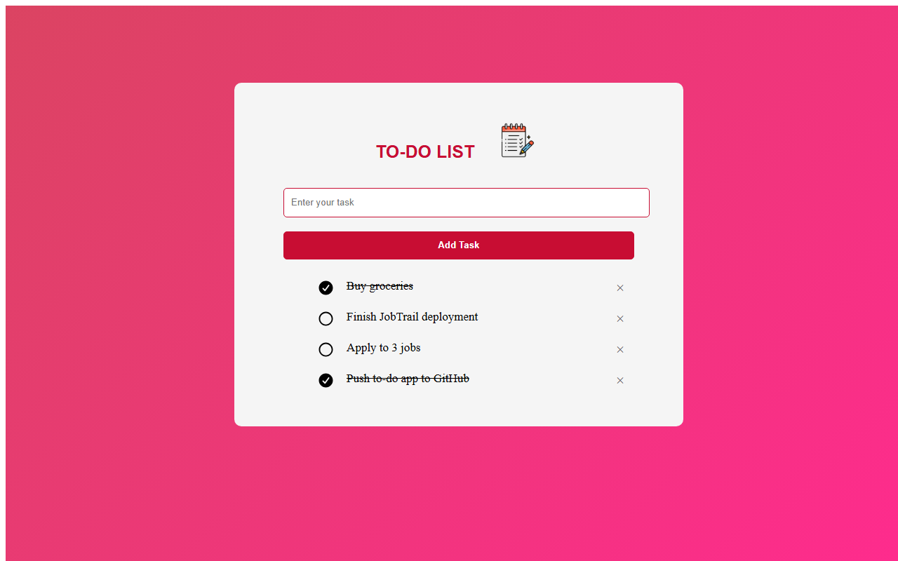

# To-Do List

A simple to-do list web app built with plain **HTML, CSS and JavaScript** — no frameworks or libraries.



## Features

- Add tasks (empty input is rejected with an alert)
- Click a task to mark it complete or not complete
- Delete a task with the **×** button
- Tasks are saved in the browser's **localStorage**, so they are still there after a page reload

## How it works

- **DOM manipulation** — `addTask()` creates a new `<li>` for each task and a `<span>` for its delete button.
- **Event delegation** — one click listener on the `<ul>` handles every task: clicking an `<li>` toggles the `check` class, and clicking a `<span>` removes the task.
- **localStorage** — `save()` stores the list after every change, and `show()` loads it again when the page opens.
- **CSS** — the round check/uncheck icons are drawn with the `::before` pseudo-element and SVG backgrounds.

## Tech used

- HTML5
- CSS3 (gradient background, pseudo-elements)
- JavaScript (ES6)

## Run locally

1. Clone the repository:

   ```bash
   git clone https://github.com/binum459/to-do-list.git
   ```

2. Open `index.html` in your browser.

   Or, to run it on a local server, open a terminal in the project folder and run:

   ```powershell
   py -m http.server 8000
   ```

   Then go to http://localhost:8000.

## Project structure

```
to-do-list/
├── index.html      # page layout
├── index.css       # styles
├── index.js        # app logic
├── images/         # app icon and check/uncheck icons
└── screenshots/    # README screenshot
```

## Future improvements

- Edit the text of an existing task
- Add a task by pressing **Enter**
- Filter tasks (all / active / completed)
- Improve the layout on mobile screens
